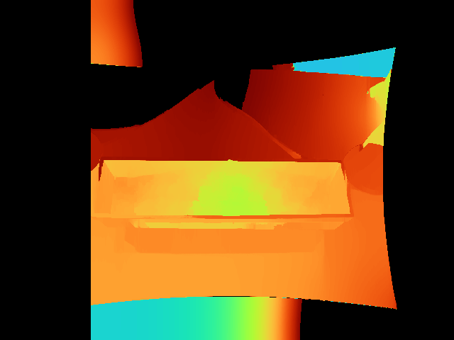
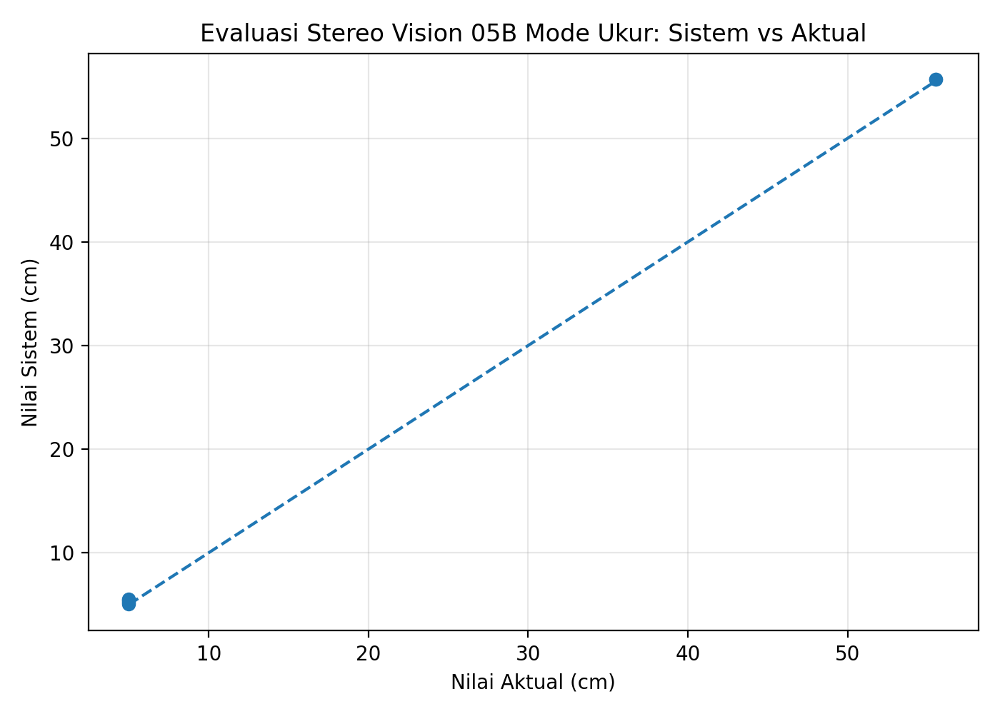
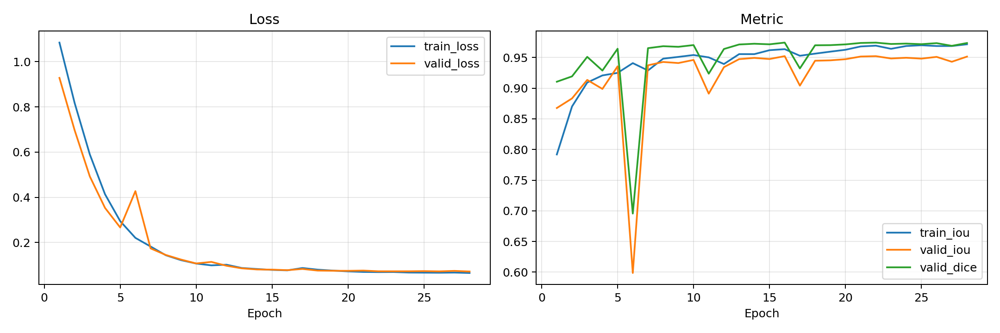
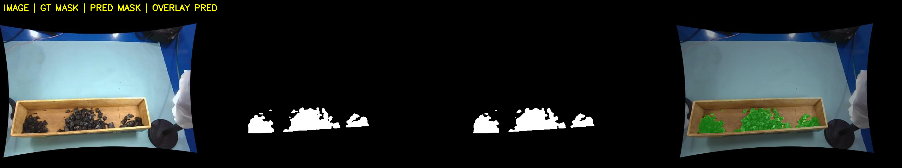
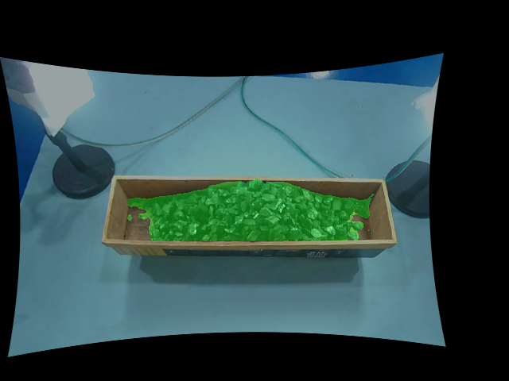
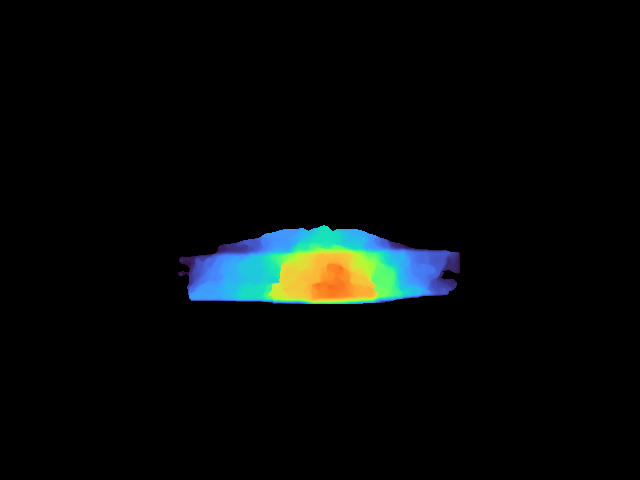
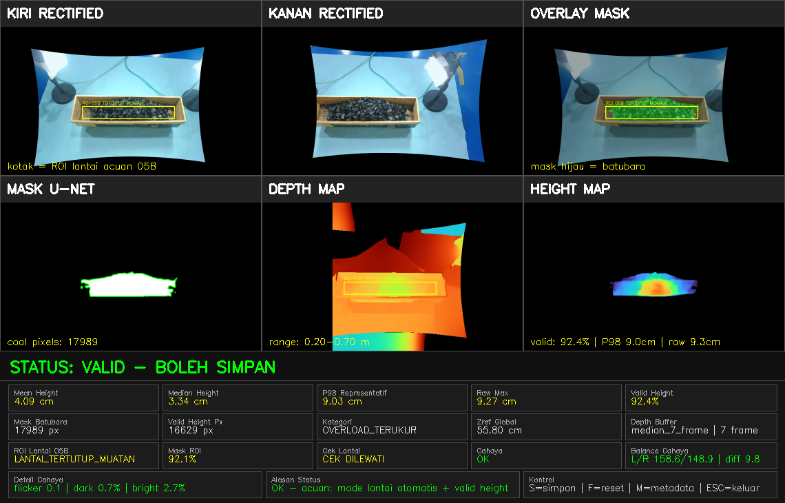
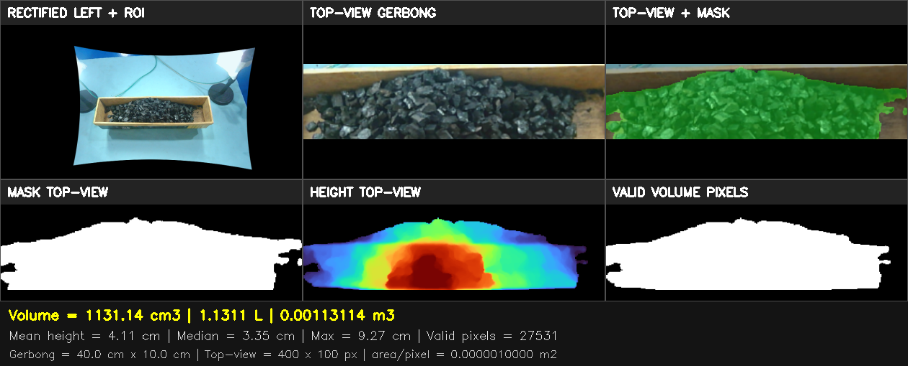
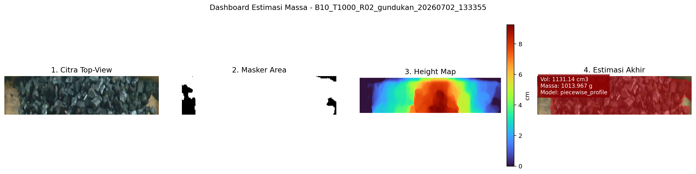

# Alur Pipeline Langkah demi Langkah

Dokumen ini menjelaskan bagaimana sistem mengubah sepasang foto gerbong menjadi estimasi massa batu bara. Seluruh gambar berasal dari **satu sampel yang sama**: tumpukan berbentuk gundukan dengan massa aktual 1000 g (kode sampel `B10_T1000_R02_gundukan`, *baseline* kamera 10 cm), sehingga setiap tahap dapat diikuti dari awal sampai akhir.

```
Foto stereo -> [1] Kalibrasi & rektifikasi -> [2] Peta kedalaman -> [3] Segmentasi U-Net
                                                   |                       |
                                                   +-----> [4] Peta tinggi <+
                                                                |
                                                  [5] Volume (homografi) -> [6] Massa
```

Nomor skrip di setiap tahap mengacu pada daftar skrip di [README](README.md).

---

## Tahap 1. Kalibrasi kamera dan rektifikasi (skrip 01 sampai 05)

**Tujuan:** membuat dua kamera dapat dipakai sebagai satu alat ukur kedalaman.

1. Papan ChArUco (5 × 7 kotak) difoto dari kamera kiri dan kanan.
2. **Kalibrasi intrinsik** menghitung sifat tiap kamera (panjang fokus, titik pusat, dan distorsi lensa).
3. **Kalibrasi stereo** menghitung posisi kamera kanan terhadap kamera kiri (rotasi dan translasi).
4. **Rektifikasi** meluruskan kedua gambar sehingga titik yang sama berada pada baris piksel yang sama. Dengan begitu pencarian pasangan titik cukup dilakukan ke arah horizontal.

Hasilnya tersimpan di folder `hasil_kalibrasi/` (misalnya `stereo_params.xml` dan `stereomap.xml`). Bentuk gambar yang sedikit melengkung pada tahap-tahap berikutnya adalah akibat rektifikasi, bukan kesalahan.

---

## Tahap 2. Peta kedalaman (skrip 06 dan 07)

**Tujuan:** mengetahui jarak setiap titik pada gambar dari kamera.

Dari sepasang gambar yang sudah direktifikasi, algoritma **StereoSGBM** mencari perbedaan posisi (*disparity*) tiap titik antara gambar kiri dan kanan. Titik yang dekat bergeser lebih jauh daripada titik yang jauh, sehingga *disparity* dapat dikonversi menjadi jarak. Hasilnya berupa **peta kedalaman** berwarna.



*Peta kedalaman sampel (rentang tampilan 0,20 sampai 0,70 m). Warna menunjukkan jarak dari kamera.*

Sebagai acuan, jarak kamera ke lantai gerbong kosong disimpan sebagai **Z_ref** (sekitar 55,80 cm pada sampel ini). Tinggi muatan diperoleh dari selisih antara Z_ref dan kedalaman permukaan muatan.

**Validasi akurasi kedalaman.** Sebelum dipakai untuk muatan, pengukuran stereo diuji pada objek yang ukurannya diketahui (7 data uji):

| Pengujian | Jumlah data | MAE |
|---|---|---|
| Jarak kamera ke lantai (aktual 55,5 cm) | 2 | 0,163 cm |
| Tinggi balok acuan (aktual 5,0 cm) | 5 | 0,317 cm |



*Titik-titik berada di dekat garis ideal, artinya pengukuran stereo sesuai dengan nilai aktual.*

---

## Tahap 3. Segmentasi batu bara dengan U-Net (skrip 08 sampai 14)

**Tujuan:** menentukan piksel mana yang merupakan batu bara, supaya tinggi hanya dihitung pada area muatan dan bukan pada dinding gerbong atau lantai.

1. **Dataset** dikumpulkan dan dianotasi manual di Roboflow (200 citra: 140 *train*, 30 *validation*, 30 *test*).
2. *Mask* diubah menjadi biner (0 = latar, 1 = batu bara), lalu **U-Net** dilatih di Google Colab.
3. Model terbaik (epoch 16) diuji pada data uji yang belum pernah dilihat model.



*Kurva loss dan metrik selama training. Metrik validasi sempat turun tajam pada epoch 6, lalu pulih dan stabil.*

Hasil pada 30 citra uji: **IoU rata-rata 0,9718** dan **Dice rata-rata 0,9856**.



*Dari kiri ke kanan: gambar asli, mask acuan (ground truth), mask prediksi, dan overlay prediksi. Mask prediksi sangat mirip dengan mask acuan.*

Pada sampel gundukan 1000 g, hasil segmentasinya (area hijau) tampak berikut:



---

## Tahap 4. Integrasi: peta tinggi (skrip 15)

**Tujuan:** menggabungkan "di mana batu bara" (tahap 3) dengan "seberapa jauh dari kamera" (tahap 2) menjadi **peta tinggi**.

Untuk setiap piksel di area batu bara, tinggi dihitung sebagai `tinggi = Z_ref - kedalaman`. Piksel di luar area batu bara diabaikan.



*Peta tinggi sampel. Warna merah menunjukkan bagian tertinggi (puncak gundukan), warna biru bagian yang lebih rendah.*

Skrip ini juga menyajikan seluruh proses dalam satu dashboard, lengkap dengan kontrol kualitas (status VALID, kondisi cahaya, dan persentase piksel tinggi yang valid):



*Baris atas: gambar kiri dan kanan hasil rektifikasi serta overlay mask. Baris bawah: mask U-Net, peta kedalaman, dan peta tinggi. Panel di bawahnya memuat statistik (tinggi rata-rata 4,09 cm, tinggi representatif P98 9,03 cm, 17.989 piksel batu bara) dan status kualitas data.*

---

## Tahap 5. Perhitungan volume dengan homografi (skrip 16 dan 17)

**Tujuan:** mengubah peta tinggi menjadi volume dalam satuan nyata.

1. Area gerbong pada gambar diubah dengan **homografi** menjadi pandangan dari atas (*top-view*) berukuran 400 × 100 piksel, sesuai ukuran dasar gerbong 40 × 10 cm. Dengan begitu, 1 piksel mewakili 1 mm².
2. *Mask* dan peta tinggi ikut diubah ke pandangan atas.
3. Volume dihitung dengan menjumlahkan `tinggi × luas piksel` pada seluruh piksel valid.



*Baris atas: gambar dengan ROI gerbong, pandangan atas gerbong, dan pandangan atas dengan mask. Baris bawah: mask pandangan atas, peta tinggi pandangan atas, dan piksel valid untuk perhitungan volume. Hasil sampel: **volume 1131,14 cm³** dari 27.531 piksel valid.*

---

## Tahap 6. Estimasi massa (skrip 18 sampai 20)

**Tujuan:** mengonversi volume menjadi massa.

Karena batu bara berongga dan bentuk tumpukannya bermacam-macam, massa tidak sama dengan volume dikali satu nilai densitas tetap. Karena itu dibandingkan enam model konversi, dari densitas tetap sampai regresi yang memanfaatkan profil tumpukan. Model terbaik adalah ***piecewise linear* + profil** (MAE 22,7 g, MAPE 4,1%). Perbandingan lengkap ada di [README](README.md).



*Dari kiri ke kanan: citra pandangan atas, area mask, peta tinggi, dan hasil akhir. Untuk sampel ini sistem mengestimasi volume 1131,14 cm³ dan massa 1013,97 g, dibandingkan massa aktual 1000 g (selisih sekitar 1,4%).*

---

## Ringkasan sampel

| Tahap | Keluaran | Nilai pada sampel ini |
|---|---|---|
| Segmentasi | Area batu bara | 17.989 piksel |
| Kedalaman dan tinggi | Peta tinggi | rata-rata 4,09 cm, P98 9,03 cm |
| Volume | Homografi | 1131,14 cm³ |
| Massa | Model *piecewise linear* + profil | 1013,97 g (aktual 1000 g) |

> Satu sampel hanya menggambarkan cara kerja sistem. Akurasi keseluruhan ditunjukkan oleh tabel perbandingan model di [README](README.md).
