# Alur Sistem Estimasi Massa Muatan Batu Bara

Bagian ini menjelaskan alur sistem estimasi massa batu bara pada gerbong kereta, dari foto stereo sampai angka massa. Setiap tahap memiliki **gerbang kelayakan**: kriteria yang harus dipenuhi sebelum lanjut ke tahap berikutnya.

Konfigurasi: dua webcam JETE W7, *baseline* 10 cm, miniatur gerbong 40 × 10 × 7,5 cm. Gambar tahap 4 sampai 6 berasal dari satu sampel yang sama (gundukan, massa aktual 1000 g).

Bagian dengan segitiga di sisi kirinya dapat dibuka untuk melihat detail tambahan.

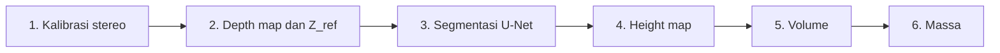

<details>
<summary><b>Kriteria kelayakan tiap tahap</b></summary>

| Tahap | Kriteria lolos | Hasil |
|---|---|---|
| 1. Kalibrasi | RMS < 0,5 px; sudut ChArUco ≥ 15; garis epipolar sejajar | RMS stereo 0,3848 px |
| 2. Stereo vision | Error < 1 cm; piksel valid ≥ 85% | Error maksimum 0,55 cm; piksel valid 100% |
| 3. Segmentasi | IoU > 0,70; Dice > 0,70; Pixel Accuracy > 95% | IoU 0,9718; Dice 0,9856 |
| 4. Height map | Piksel height valid ≥ 70%; tinggi 0 sampai 12 cm | Rata-rata 92,83% valid |
| 5. Volume | ≥ 20 piksel valid; ROI 40 × 10 cm | 66 sampel valid |
| 6. Massa | MAPE ≤ 10 sampai 20%; R² ≥ 90%; MAE ≤ 300 g; RMSE ≤ 400 g | MAPE 4,1%; R² 0,9978 |

</details>

<p align="center">
<a href="#1-kalibrasi-dan-rektifikasi-stereo">1 Kalibrasi</a> &nbsp;·&nbsp; <a href="#2-depth-map-z_ref-dan-uji-balok-acuan">2 Depth dan uji balok</a> &nbsp;·&nbsp; <a href="#3-segmentasi-batu-bara-dengan-u-net">3 Segmentasi</a> &nbsp;·&nbsp; <a href="#4-integrasi-menjadi-height-map">4 Height map</a> &nbsp;·&nbsp; <a href="#5-perhitungan-volume">5 Volume</a> &nbsp;·&nbsp; <a href="#6-estimasi-massa">6 Massa</a>
</p>

---

## 1. Kalibrasi dan rektifikasi stereo

*Skrip 01 sampai 05.* Dua kamera dikalibrasi dengan papan ChArUco sehingga dapat dipakai sebagai satu alat ukur kedalaman. Rektifikasi kemudian meluruskan kedua gambar, sehingga titik yang sama berada pada baris piksel yang sama (garis hijau horizontal di kanan).

<table>
<tr>
<td width="50%">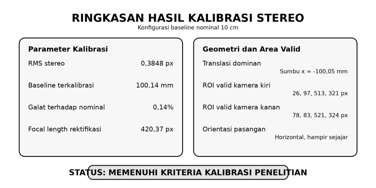</td>
<td width="50%">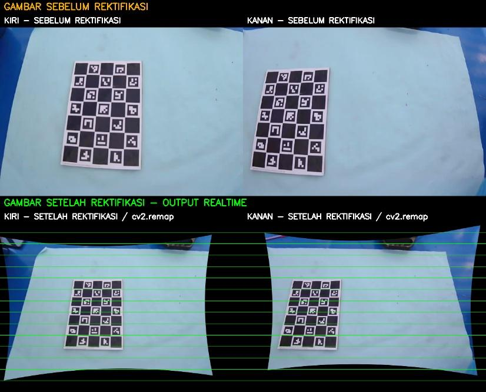</td>
</tr>
<tr>
<td align="center"><sub>Ringkasan kalibrasi: RMS 0,3848 px, baseline terkalibrasi 100,14 mm</sub></td>
<td align="center"><sub>Sebelum dan sesudah rektifikasi</sub></td>
</tr>
</table>

**Hasil:** baseline hasil kalibrasi hanya berselisih 0,14% dari nominal 10 cm.

<details>
<summary><b>Setup kamera dan deteksi ChArUco</b></summary>

<table>
<tr>
<td width="34%">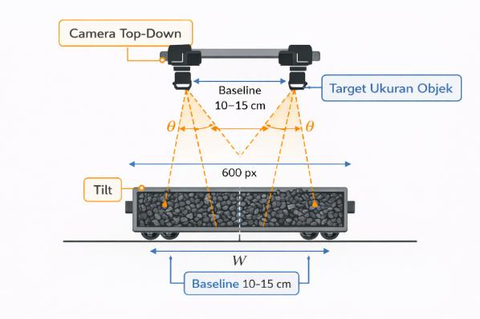</td>
<td width="33%">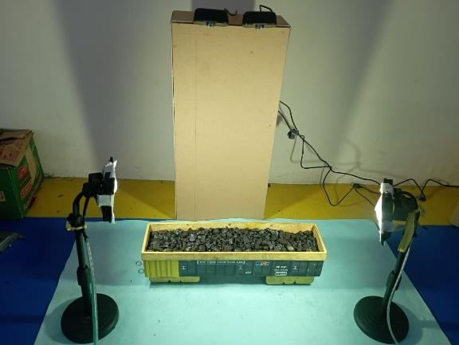</td>
<td width="33%">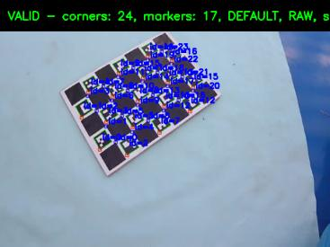</td>
</tr>
<tr>
<td align="center"><sub>Konfigurasi kamera top-down</sub></td>
<td align="center"><sub>Setup di laboratorium</sub></td>
<td align="center"><sub>Deteksi sudut ChArUco (VALID)</sub></td>
</tr>
</table>

Papan ChArUco berukuran 7 × 5 kotak (kotak 39 mm, marker 29 mm) difoto dari berbagai pose.

</details>

---

## 2. Depth map, Z_ref, dan uji balok acuan

*Skrip 06 dan 07.* Algoritma **StereoSGBM** mengubah selisih posisi titik pada gambar kiri dan kanan menjadi jarak. Tinggi muatan diperoleh dari selisih antara lantai gerbong dan permukaan material:

```
tinggi = Z_ref - kedalaman permukaan
```

Z_ref (jarak ke lantai gerbong kosong) ditetapkan lebih dulu pada ROI kuning. Ketelitiannya kemudian diuji dengan **balok kertas setinggi 5 cm** pada ROI biru sebelum sistem dipakai untuk batu bara.

<table>
<tr>
<td width="50%">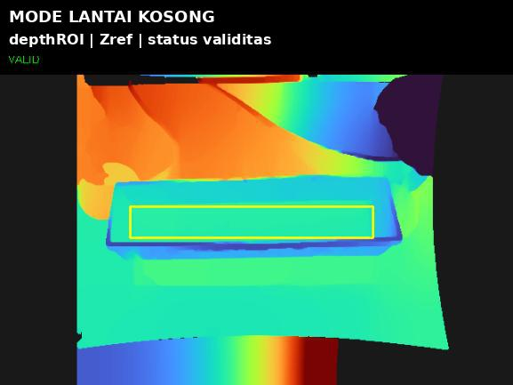</td>
<td width="50%">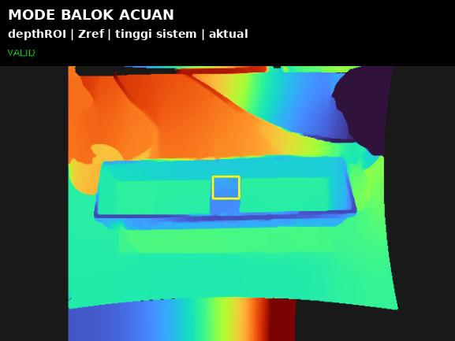</td>
</tr>
<tr>
<td align="center"><sub>Penetapan Z_ref pada gerbong kosong</sub></td>
<td align="center"><sub>Uji tinggi dengan balok acuan 5 cm</sub></td>
</tr>
</table>

**Hasil dari 7 titik uji:** error maksimum **0,55 cm** (batas 1 cm), MAE 0,273 cm, piksel valid 100%. Nilai sistem selalu sedikit di atas nilai aktual (bias sekitar +0,16 cm pada jarak lantai dan +0,32 cm pada tinggi balok). Bias kecil ini dapat terakumulasi saat dijumlahkan menjadi volume.

<details>
<summary><b>Tabel tujuh titik uji, grafik, dan perbandingan depth map</b></summary>

| No. | Jenis uji | Aktual (cm) | Sistem (cm) | Error (cm) |
|---|---|---|---|---|
| 1 | Jarak lantai | 55,50 | 55,66 | 0,16 |
| 2 | Jarak lantai | 55,50 | 55,66 | 0,16 |
| 3 | Tinggi balok | 5,00 | 5,02 | 0,02 |
| 4 | Tinggi balok | 5,00 | 5,47 | 0,47 |
| 5 | Tinggi balok | 5,00 | 5,33 | 0,33 |
| 6 | Tinggi balok | 5,00 | 5,21 | 0,21 |
| 7 | Tinggi balok | 5,00 | 5,55 | 0,55 |

| Kategori | Jumlah data | MAE (cm) | RMSE (cm) | MAPE (%) |
|---|---|---|---|---|
| Jarak lantai | 2 | 0,163 | 0,163 | 0,29 |
| Tinggi balok | 5 | 0,317 | 0,368 | 6,33 |
| Keseluruhan | 7 | 0,273 | 0,323 | 4,61 |

<table>
<tr>
<td width="50%">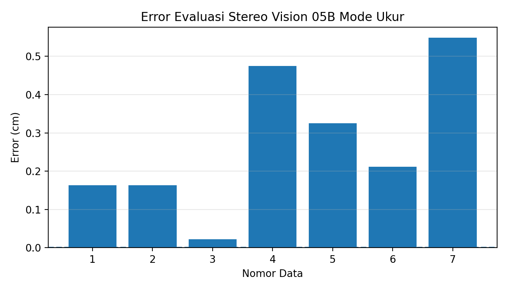</td>
<td width="50%"></td>
</tr>
</table>

Depth map pada titik dengan error terendah (titik 3) dan tertinggi (titik 7). Selisihnya terutama berasal dari pergeseran median kedalaman ketika posisi ROI berpindah, bukan dari berkurangnya piksel valid:

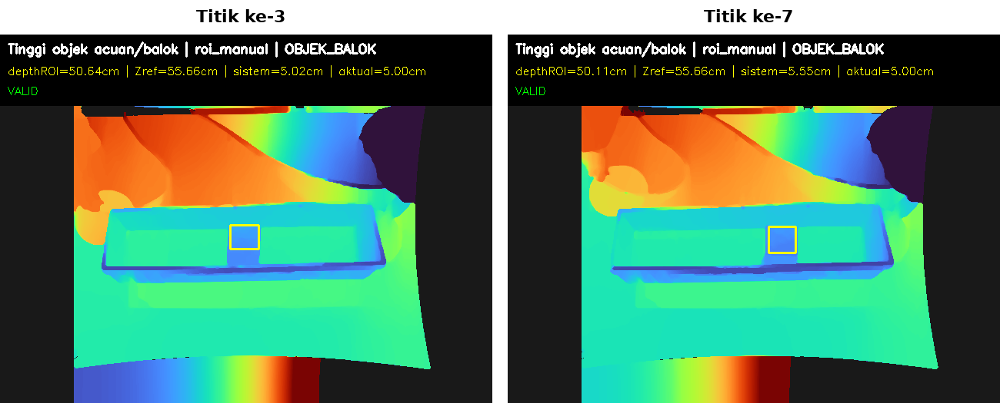

</details>

---

## 3. Segmentasi batu bara dengan U-Net

*Skrip 08 sampai 14.* U-Net menandai piksel mana yang merupakan batu bara, supaya tinggi hanya dihitung pada area muatan dan bukan pada dinding atau lantai gerbong. Dataset terdiri dari 200 citra yang dianotasi manual di Roboflow dan dibagi 140 *training*, 30 *validation*, dan 30 *testing*.


<sub>Dari kiri ke kanan: gambar asli, mask acuan, mask prediksi, dan overlay prediksi.</sub>

**Hasil pada 30 citra uji:** IoU **0,9718** dan Dice **0,9856**.

<details>
<summary><b>Dataset, anotasi, dan kurva training</b></summary>

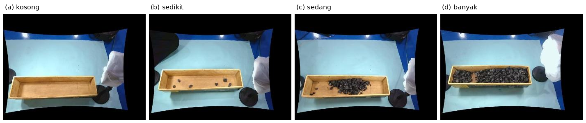

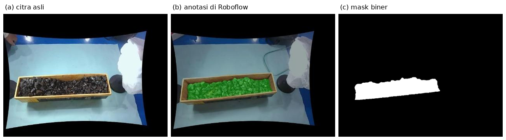


Metrik validasi sempat turun tajam pada epoch 6, lalu pulih dan stabil.

</details>

---

## 4. Integrasi menjadi height map

*Skrip 15.* Mask U-Net ("di mana batu bara") digabungkan dengan depth map ("seberapa jauh dari kamera") menjadi peta tinggi. Untuk setiap piksel di dalam mask, tinggi dihitung sebagai `Z_ref - kedalaman`. Seluruh proses ditampilkan dalam satu dashboard:


<sub>Baris atas: gambar kiri, kanan, dan overlay mask. Baris bawah: mask U-Net, peta kedalaman, dan peta tinggi. Panel bawah memuat statistik dan status kualitas data.</sub>

**Hasil:** pada 66 sampel, rata-rata 92,83% piksel height valid (batas minimum 70%).

---

## 5. Perhitungan volume

*Skrip 16 dan 17.* Area gerbong diubah dengan **homografi** menjadi pandangan dari atas berukuran 400 × 100 piksel (1 piksel mewakili 1 mm²). Volume diperoleh dengan menjumlahkan `tinggi × luas piksel` pada seluruh piksel valid.


<sub>Hasil sampel: volume 1131,14 cm³ dari 27.531 piksel valid.</sub>

<details>
<summary><b>Transformasi homografi dan hubungan volume dengan massa</b></summary>

<table>
<tr>
<td width="50%">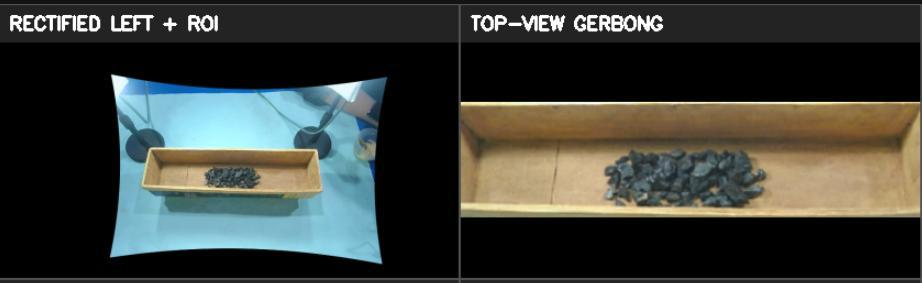</td>
<td width="50%">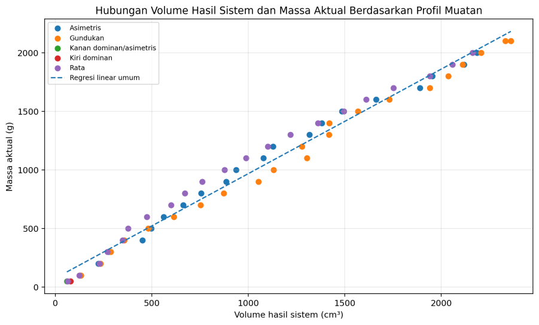</td>
</tr>
<tr>
<td align="center"><sub>Gambar kiri dengan ROI menjadi pandangan atas</sub></td>
<td align="center"><sub>Hubungan volume dan massa menurut profil muatan</sub></td>
</tr>
</table>

</details>

---

## 6. Estimasi massa

*Skrip 18 sampai 20.* Volume dikonversi menjadi massa. Enam model dibandingkan secara bertahap: dimulai dari asumsi fisika paling sederhana (massa = densitas × volume), lalu setiap model menambahkan satu hal, yaitu kalibrasi dari data, kelengkungan hubungan volume dan massa, serta bentuk muatan.

| Model | Cara menghitung | Variabel yang dipakai |
|---|---|---|
| 1. Densitas manual | massa = 0,83 g/cm³ × volume | volume |
| 2. Densitas empiris | massa = 0,959 g/cm³ × volume (median massa per volume dari data) | volume |
| 3. *Linear regression* | satu garis lurus: massa = 0,892 × volume + 76,2 | volume |
| 4. *Piecewise linear* | garis berbeda untuk tiga rentang volume (< 647, 647 sampai 1419, dan > 1419 cm³) | volume |
| 5. *Multiple regression* + profil | regresi dari beberapa ukuran geometri dan bentuk muatan | volume, tinggi (rata-rata, median, maksimum, P95, P98), piksel valid, luas area, profil muatan |
| 6. ***Piecewise linear* + profil** | seperti model 4, ditambah koreksi menurut bentuk muatan | volume, profil muatan |

<sub>Profil muatan adalah bentuk permukaan tumpukan (rata, gundukan, atau asimetris). Data kalibrasi terdiri dari 66 sampel dengan massa 50 sampai 2100 g yang ditimbang dengan timbangan digital. Model 2 sampai 6 menyesuaikan parameternya pada data ini, sedangkan model 1 memakai densitas tetap.</sub>

Model utama adalah ***piecewise linear* + profil**. Hasil akhir pada sampel contoh:


<sub>Dari kiri ke kanan: citra pandangan atas, mask, peta tinggi, dan hasil akhir. Sampel ini diestimasi 1013,97 g dari massa aktual 1000 g (selisih sekitar 1,4%).</sub>

| | MAE | MAPE | R² |
|---|---|---|---|
| Seluruh data (66 sampel) | 22,7 g | 4,1% | 0,9978 |
| Data uji (13 sampel, 80:20) | 29,1 g | 4,1% | 0,9960 |

<details>
<summary><b>Perbandingan hasil keenam model dan cara menilainya</b></summary>

| Peringkat | Model | MAE (g), 66 sampel | MAPE, 66 sampel | MAE uji (g), 13 sampel | MAPE uji, 13 sampel |
|---|---|---|---|---|---|
| 1 | ***Piecewise linear* + profil** | **22,68** | **4,13%** | 29,11 | **4,10%** |
| 2 | *Multiple regression* + profil | 26,55 | 6,60% | **26,74** | 5,50% |
| 3 | *Piecewise linear* | 46,20 | 7,07% | 44,22 | 6,07% |
| 4 | *Linear regression* | 67,61 | 19,45% | 61,11 | 12,46% |
| 5 | Densitas empiris | 76,14 | 10,13% | 78,84 | 9,86% |
| 6 | Densitas manual (0,83 g/cm³) | 145,53 | 15,15% | 145,50 | 15,50% |

**Cara menilai**

- **MAE**: rata-rata selisih absolut antara massa sistem dan timbangan (gram).
- **MAPE**: rata-rata selisih relatif terhadap massa aktual (%).
- **R²**: tingkat kecocokan model dengan data, 1 berarti sempurna.
- **Data uji**: 13 sampel (20%) dipisahkan terlebih dulu. Parameter model dicocokkan hanya pada 53 sampel lainnya, sehingga hasilnya menggambarkan kemampuan memprediksi sampel baru.
- **Peringkat**: jumlah ranking lima indikator (MAE, RMSE, MAPE, R², dan banyaknya sampel dengan error tinggi) pada seluruh data.

Model *piecewise linear* + profil dipilih karena MAPE dan RMSE ujinya terendah.

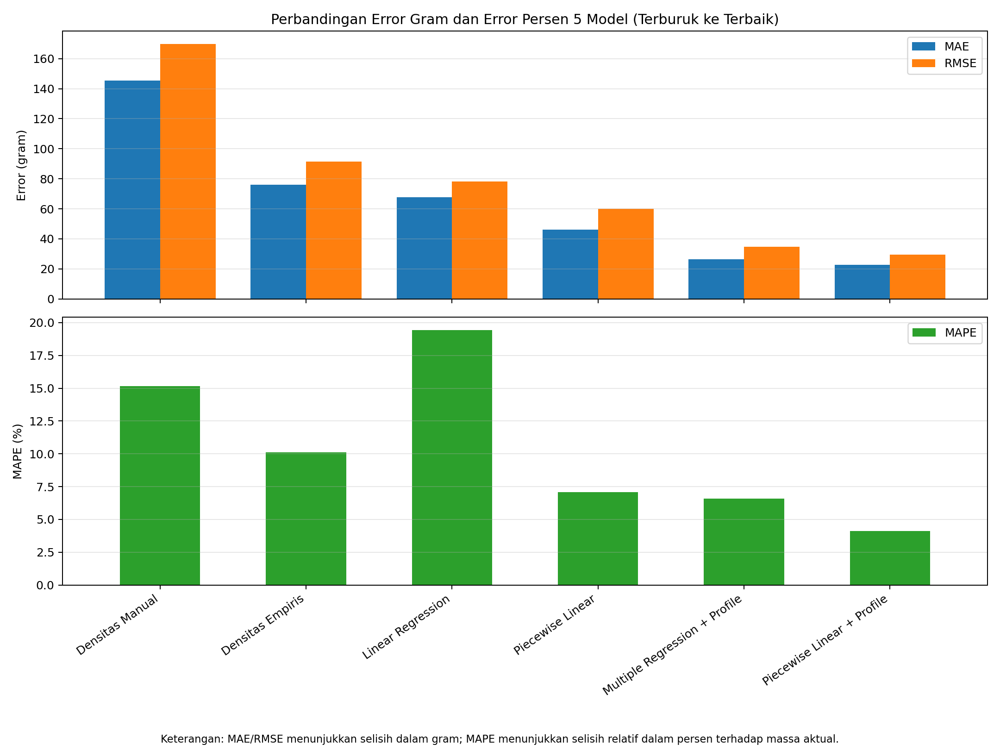

</details>

---

## Keterbatasan

- Evaluasi massa memakai satu pembagian 80:20 (13 sampel uji). Validasi silang berulang masih diperlukan.
- Sistem diuji pada miniatur skala laboratorium; kondisi lapangan belum diuji.
- *Baseline* 15 cm baru diuji pada tahap kalibrasi, sehingga perbandingan akurasi volume dan massa antar-*baseline* belum dapat dilakukan.
