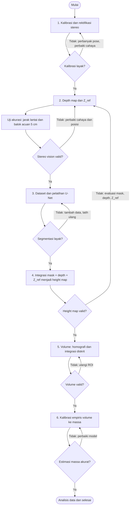

# Alur Sistem Estimasi Massa Muatan Batubara

Bagian ini menjelaskan alur sistem estimasi massa batu bara pada gerbong kereta. Setiap tahap memuat tujuan, dokumentasi visual yang paling penting, dan **gerbang kelayakan** (kriteria yang harus dipenuhi sebelum lanjut ke tahap berikutnya). Hanya dokumentasi yang menjelaskan proses yang ditampilkan di sini. Seluruh hasil lengkap tersedia di folder `hasil_...`.

Konfigurasi: dua webcam JETE W7 dalam susunan *top-down*, *baseline* 10 cm, miniatur gerbong 40 × 10 × 7,5 cm. Kecuali disebutkan lain, gambar dari tahap 4 sampai 6 berasal dari **satu sampel yang sama**: tumpukan berbentuk gundukan dengan massa aktual 1000 g (`B10_T1000_R02_gundukan`).

## Diagram alir ringkas



| Gerbang | Kriteria lolos | Hasil penelitian |
|---|---|---|
| 1. Kalibrasi | RMS < 0,5 px; sudut ChArUco terdeteksi ≥ 15; garis epipolar sejajar; ROI tetap terlihat | RMS stereo 0,3848 px (lolos) |
| 2. Stereo vision | Error < 1 cm; piksel valid ≥ 85%; tampilan depth stabil | Error maksimum 0,55 cm; piksel valid 100% (lolos) |
| 3. Segmentasi | IoU > 0,70; Dice > 0,70; Pixel Accuracy > 95% | IoU 0,9718; Dice 0,9856 (lolos) |
| 4. Height map | Piksel height valid ≥ 70%; ROI lantai sesuai; tinggi 0 sampai 12 cm | Rata-rata 92,83% valid (lolos) |
| 5. Volume | ≥ 20 piksel valid; ROI 40 × 10 cm; volume normal ≤ 3000 cm³, *overload* ringan > 3000 sampai 4800 cm³ | 66 sampel valid |
| 6. Estimasi massa | MAPE ≤ 10 sampai 20%; R² ≥ 90%; MAE ≤ 300 g; RMSE ≤ 400 g | MAPE 4,1%; R² 0,9978 (lolos) |

---

## Tahap 1. Kalibrasi dan rektifikasi stereo (skrip 01 sampai 05)

**Tujuan:** membuat dua kamera dapat dipakai sebagai satu alat ukur kedalaman.

Dua webcam dipasang berjarak 10 cm (*baseline*) dengan kemiringan 10 sampai 15°, menghadap gerbong dari atas.


Papan ChArUco (7 × 5 kotak, kotak 39 mm, marker 29 mm) difoto dari berbagai pose. Sudut dan ID marker yang terdeteksi ditandai pada gambar, dan status deteksi ditampilkan sebagai VALID bila jumlah sudut cukup.


Kalibrasi intrinsik dan stereo menghasilkan parameter kamera dan geometri pasangan kamera. Baseline hasil kalibrasi 100,14 mm hanya berselisih 0,14% dari nominal 10 cm.


**Rektifikasi** meluruskan kedua gambar sehingga titik yang sama berada pada baris piksel yang sama. Garis hijau horizontal menunjukkan garis epipolar yang sudah sejajar.


---

## Tahap 2. Depth map, Z_ref, dan uji balok acuan (skrip 06 dan 07)

**Tujuan:** mengukur jarak setiap titik dari kamera, lalu memastikan pengukuran itu cukup akurat sebelum dipakai untuk muatan.

Algoritma **StereoSGBM** mencari pergeseran posisi (*disparity*) tiap titik antara gambar kiri dan kanan, lalu mengonversinya menjadi jarak. Tinggi muatan tidak dibaca langsung dari depth map, tetapi dari selisih antara bidang dasar gerbong dan permukaan material:

```
tinggi = Z_ref - kedalaman permukaan
```

**Penetapan Z_ref.** Pada gerbong kosong, pengguna memilih ROI lantai (kotak kuning). Nilai median kedalaman yang robust disimpan sebagai Z_ref, dan status VALID hanya muncul bila jumlah piksel, kestabilan depth, dan rentang jarak memenuhi kriteria.


### Uji akurasi dengan balok acuan

Sebelum dipakai untuk batubara, ketelitian pengukuran diuji pada objek yang ukurannya diketahui: **balok kertas setinggi 5 cm** dan jarak lantai gerbong kosong (55,5 cm). Pada mode balok acuan, ROI kecil (kotak biru) ditempatkan di permukaan balok. Sistem menghitung tinggi balok dari selisih Z_ref dan kedalaman permukaan balok, lalu membandingkannya dengan nilai aktual.


Pengujian memakai tujuh titik: dua pengukuran jarak lantai dan lima pengukuran tinggi balok.

| No. | Jenis uji | Aktual (cm) | Sistem (cm) | Error (cm) | Piksel valid |
|---|---|---|---|---|---|
| 1 | Jarak lantai | 55,50 | 55,66 | 0,16 | 100% |
| 2 | Jarak lantai | 55,50 | 55,66 | 0,16 | 100% |
| 3 | Tinggi balok | 5,00 | 5,02 | 0,02 | 100% |
| 4 | Tinggi balok | 5,00 | 5,47 | 0,47 | 100% |
| 5 | Tinggi balok | 5,00 | 5,33 | 0,33 | 100% |
| 6 | Tinggi balok | 5,00 | 5,21 | 0,21 | 100% |
| 7 | Tinggi balok | 5,00 | 5,55 | 0,55 | 100% |

| Kategori | Jumlah data | MAE (cm) | RMSE (cm) | MAPE (%) |
|---|---|---|---|---|
| Jarak lantai | 2 | 0,163 | 0,163 | 0,29 |
| Tinggi balok | 5 | 0,317 | 0,368 | 6,33 |
| Keseluruhan | 7 | 0,273 | 0,323 | 4,61 |


Perbandingan titik dengan error terendah (titik 3) dan tertinggi (titik 7) menunjukkan bahwa selisih terutama berasal dari pergeseran median kedalaman ketika posisi ROI berpindah, bukan dari berkurangnya piksel valid:


**Hasil:** semua titik memiliki error di bawah 1 cm (maksimum 0,55 cm) dan piksel valid 100%, sehingga **gerbang 2 terpenuhi**. Nilai sistem selalu sedikit di atas nilai aktual (bias sekitar +0,16 cm pada jarak lantai dan +0,32 cm pada tinggi balok). Bias kecil ini perlu diperhatikan karena dapat terakumulasi ketika seluruh area mask dijumlahkan menjadi volume.

---

## Tahap 3. Dataset dan segmentasi U-Net (skrip 08 sampai 14)

**Tujuan:** menentukan piksel mana yang merupakan batubara, supaya tinggi hanya dihitung pada area muatan dan bukan pada dinding gerbong atau lantai.

Dataset berisi **200 citra kiri terektifikasi** (640 × 480 piksel) yang dikumpulkan bertahap dari gerbong kosong sampai *overload* ringan, dengan variasi profil permukaan (rata, dominan satu sisi, gundukan, asimetris).


Area batubara dianotasi manual di Roboflow, lalu diubah menjadi **mask biner** (putih = batubara, hitam = latar). Gerbong kosong dipertahankan dengan mask kosong agar model belajar menolak latar belakang.


Data dibagi 70% *training* (140), 15% *validation* (30), dan 15% *testing* (30). Augmentasi hanya diterapkan pada data *training*. U-Net dilatih di Google Colab.


*Metrik validasi sempat turun tajam pada epoch 6, lalu pulih dan stabil.*

Pada 30 citra uji, model mencapai **IoU 0,9718 dan Dice 0,9856**, sehingga **gerbang 3 terpenuhi**. Dari kiri ke kanan: gambar asli, mask acuan, mask prediksi, dan *overlay*.


---

## Tahap 4. Integrasi menjadi height map (skrip 15)

**Tujuan:** menggabungkan "di mana batubara" (mask U-Net) dengan "seberapa jauh dari kamera" (depth map) menjadi **peta tinggi**. Untuk setiap piksel di dalam mask, tinggi dihitung sebagai `Z_ref - kedalaman`. Piksel di luar mask diabaikan.

Seluruh proses ditampilkan dalam satu dashboard:


*Baris atas: gambar kiri dan kanan terektifikasi serta overlay mask. Baris bawah: mask U-Net, peta kedalaman, dan peta tinggi. Panel di bawahnya memuat statistik (tinggi rata-rata 4,09 cm, tinggi representatif P98 9,03 cm, 17.989 piksel batubara, 92,4% piksel tinggi valid) dan status kualitas data.*

**Gerbang 4:** pada 66 sampel, persentase piksel height valid berkisar 80,05% sampai 99,33% (rata-rata 92,83%), di atas ambang 70%.

---

## Tahap 5. Perhitungan volume (skrip 16 dan 17)

**Tujuan:** mengubah peta tinggi menjadi volume dalam satuan nyata.

Area gerbong diubah dengan **homografi** menjadi pandangan dari atas (*top-view*) berukuran 400 × 100 piksel sesuai dasar gerbong 40 × 10 cm, sehingga 1 piksel mewakili 1 mm².


Volume dihitung dengan menjumlahkan `tinggi × luas piksel` pada seluruh piksel valid.


*Hasil sampel: volume 1131,14 cm³ dari 27.531 piksel valid.*

Volume sistem berhubungan erat dengan massa aktual, tetapi hubungannya tidak sepenuhnya seragam untuk semua profil muatan:


---

## Tahap 6. Estimasi massa (skrip 18 sampai 20)

**Tujuan:** mengonversi volume menjadi massa. Enam model dibandingkan, dari densitas tetap sampai regresi *piecewise* yang memanfaatkan profil tumpukan.

| Peringkat | Model | MAE (g), 66 sampel | MAPE, 66 sampel | MAE uji (g), 13 sampel | MAPE uji, 13 sampel |
|---|---|---|---|---|---|
| 1 | ***Piecewise linear* + profil** | **22,68** | **4,13%** | 29,11 | **4,10%** |
| 2 | *Multiple regression* + profil | 26,55 | 6,60% | **26,74** | 5,50% |
| 3 | *Piecewise linear* | 46,20 | 7,07% | 44,22 | 6,07% |
| 4 | *Linear regression* | 67,61 | 19,45% | 61,11 | 12,46% |
| 5 | Densitas empiris | 76,14 | 10,13% | 78,84 | 9,86% |
| 6 | Densitas manual | 145,53 | 15,15% | 145,50 | 15,50% |

Kolom "66 sampel" menunjukkan kemampuan model mencocokkan seluruh data, sedangkan kolom "uji" dihitung pada 13 sampel (20%) yang tidak dipakai saat pencocokan parameter. Model *piecewise linear* + profil dipilih sebagai model utama karena MAPE dan RMSE uji terendah, meskipun MAE ujinya sedikit lebih tinggi daripada *multiple regression* + profil. Model terbaik mencapai R² 0,9978 pada seluruh data.


Hasil akhir pada sampel contoh: sistem mengestimasi **massa 1013,97 g** dari massa aktual 1000 g (selisih sekitar 1,4%).


*Dari kiri ke kanan: citra pandangan atas, area mask, peta tinggi, dan hasil akhir (volume, massa, dan model yang dipakai).*

**Gerbang 6 terpenuhi:** MAPE 4,1% (batas 10 sampai 20%), R² 0,9978 (batas 90%), MAE 22,7 g (batas 300 g), dan RMSE 29,4 g (batas 400 g).

---

## Catatan keterbatasan

- Evaluasi massa memakai satu pembagian 80:20 dengan 13 sampel uji. Validasi silang berulang masih diperlukan untuk menilai kestabilan performa.
- Sistem diuji pada miniatur skala laboratorium. Kondisi lapangan (debu, getaran, pencahayaan, dan ukuran gerbong sebenarnya) belum diuji.
- Konfigurasi *baseline* 15 cm baru diuji pada tahap kalibrasi. Perbandingan akurasi volume dan massa antara *baseline* 10 cm dan 15 cm belum dapat dilakukan.
