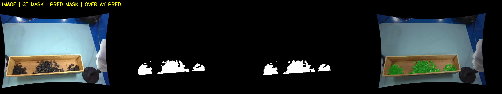
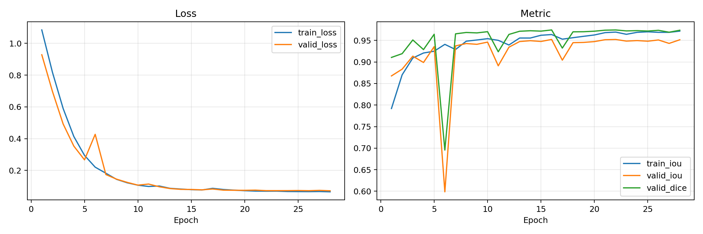
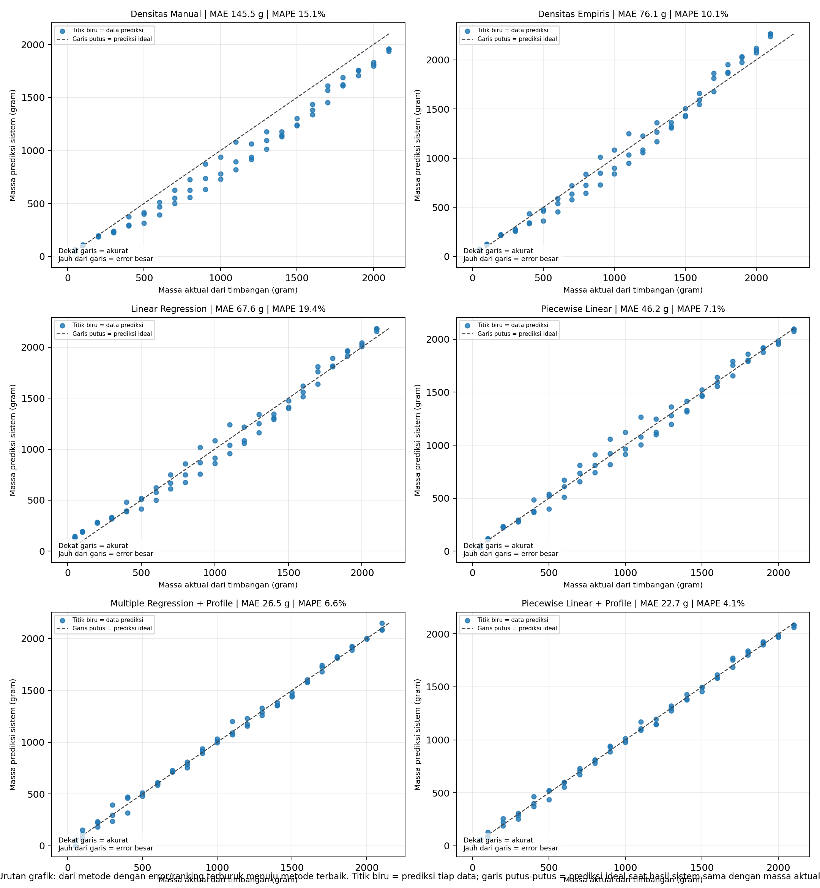
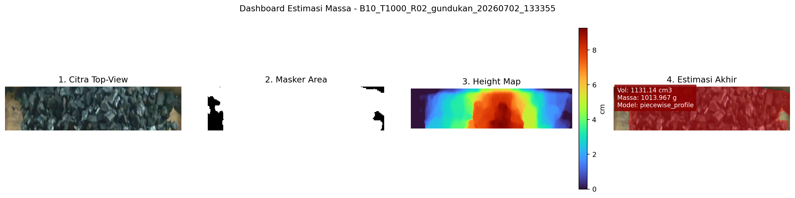

# coal-mass-estimation-cv

Non-contact coal payload mass estimation prototype using **U-Net semantic segmentation** and **stereo vision depth reconstruction**.

Sistem tanpa kontak sebagai alternatif timbangan rel statis atau sensor mahal untuk mengestimasi massa muatan batu bara pada gerbong. Segmentasi semantik U-Net mengenali area batu bara, sedangkan stereo vision mengukur tinggi tumpukan. Keduanya digabungkan untuk menghitung volume, lalu dikonversi menjadi massa. Sistem diuji pada miniatur skala laboratorium, mulai dari pengumpulan data hingga evaluasi model.

> Proyek ini merupakan bagian dari skripsi Teknik Elektro, Universitas Airlangga.

---

## Hasil Utama (baseline 10 cm)

| Komponen | Hasil |
|---|---|
| Segmentasi U-Net (test set) | IoU 0,9718 |
| Estimasi massa, model terbaik (*piecewise linear* dengan profil) | MAPE sekitar 4,1%, R² sekitar 0,9978 |

Detail metrik dan perbandingan seluruh model ada di folder `hasil_18_perbandingan_5_model_estimasi_massa/00_ringkasan_hasil/`.

### Contoh visual

**Segmentasi U-Net** (kolom: gambar, *ground truth*, prediksi, *overlay*):



**Kurva training:**



**Perbandingan model estimasi massa (aktual vs prediksi):**



**Dashboard estimasi per sampel:**



---

## Gambaran Sistem

- **Objek uji:** miniatur gerbong batu bara berukuran 40 × 10 × 7,5 cm
- **Kamera:** tiga webcam dalam susunan tetap (satu kamera kiri bersama dan dua kamera kanan untuk dua variasi *baseline*, 10 cm dan 15 cm)
- **Kalibrasi:** papan ChArUco 5 × 7, kalibrasi intrinsik dan stereo, lalu rektifikasi
- **Segmentasi:** U-Net biner (batu bara vs latar), dilatih pada 200 citra (140 *train*, 30 *validation*, 30 *test*) yang dianotasi di Roboflow
- **Estimasi tinggi:** peta kedalaman stereo (StereoSGBM), lalu peta tinggi tumpukan di dalam area hasil segmentasi
- **Volume:** integrasi peta tinggi dengan homografi
- **Massa:** konversi volume ke massa dengan beberapa strategi model yang dibandingkan

Alur lengkap:

```
Capture ChArUco -> Kalibrasi -> Rektifikasi -> Depth map
        |
Akuisisi dataset -> Anotasi -> Preprocessing -> Training U-Net -> Inferensi
        |
Integrasi U-Net + depth -> Volume (homografi) -> Estimasi massa
```

---

## Urutan Skrip

Skrip diberi nomor sesuai urutan pengerjaan. Ringkasan urutan juga ada di `00_README_URUTAN_ALUR_MASSA.txt`.

| No. | Skrip | Fungsi |
|---|---|---|
| 01 | `01_06_CAPTURE_CHARUCO_STEREO_...` | Pengambilan citra ChArUco stereo |
| 02 | `02_02_kalibrasi_intrinsik_charuco_...` | Kalibrasi intrinsik kamera kiri dan kanan |
| 03 | `03_03_kalibrasi_stereo_CHARUCO_XML_...` | Kalibrasi stereo (parameter ekstrinsik) |
| 04 | `04_04_rektifikasi_stereomap_realtime_...` | Rektifikasi dan pembuatan *stereo map* |
| 05 | `05_15C_evaluasi_kalibrasi_stereo_rektifikasi` | Evaluasi hasil kalibrasi dan rektifikasi |
| 06 | `06_05_depth_map_...` | Pembuatan peta kedalaman |
| 07 | `07_05B_evaluasi_stereo_depth_lantai_objek_...` | Evaluasi akurasi kedalaman stereo |
| 08 | `08_06_akuisisi_dataset_UNET_VARIATIF_200_...` | Akuisisi dataset U-Net |
| 09 | `09_ROBOFLOW_ANOTASI_MANUAL.txt` | Panduan anotasi manual di Roboflow |
| 10 | `10_07_preprocess_roboflow_binary_unet_...` | Preprocessing hasil ekspor Roboflow |
| 11 | `11_08_fix_mask_to_binary_01_...` | Normalisasi *mask* menjadi biner (0/1) |
| 12 | `12_09_train_unet_binary_batubara_COLAB_...ipynb` | Training U-Net (Google Colab) |
| 13 | `13_10_inference_unet_batubara_...` | Inferensi segmentasi |
| 14 | `14_15B_evaluasi_segmentasi_semantik_unet` | Evaluasi segmentasi (IoU, Dice, precision, recall) |
| 15 | `15_11_integrasi_unet_depth_heightmap_...` | Integrasi segmentasi dan kedalaman menjadi peta tinggi |
| 16 | `16_12_hitung_volume_homografi_BATCH_...` | Perhitungan volume dengan homografi |
| 17 | `17_15D_evaluasi_volume_homografi_SELARAS` | Evaluasi volume |
| 18 | `18_perbandingan_5_model_estimasi_massa` | Perbandingan model konversi volume ke massa |
| 19 | `19_estimasi_massa_semua_model_NEAR_REALTIME` | Estimasi massa dengan semua model |
| 20 | `20_16_demo_realtime_volume_massa_PER_BASELINE` | Demo *near real-time* per *baseline* |

---

## Struktur Folder

| Folder | Isi |
|---|---|
| `hasil_kalibrasi/` | Parameter kalibrasi, matriks stereo, dan *stereo map* |
| `hasil_evaluasi_stereo_05b_mode_ukur/` | Evaluasi pengukuran kedalaman |
| `hasil_training_unet_colab/` | Kurva training, riwayat training, dan contoh prediksi |
| `hasil_evaluasi_unet/` | Metrik segmentasi per citra dan contoh *overlay* |
| `hasil_inference_unet/` | Contoh hasil inferensi |
| `hasil_integrasi_unet_depth/` | Contoh hasil integrasi segmentasi dan kedalaman |
| `hasil_volume_homografi/` | Contoh hasil perhitungan volume |
| `hasil_evaluasi_volume_homografi/` | Evaluasi volume |
| `hasil_18_perbandingan_5_model_estimasi_massa/` | Perbandingan model estimasi massa |
| `hasil_18_kalibrasi_empiris_massa/` | Data kalibrasi empiris massa |
| `hasil_19_estimasi_massa_semua_model/` | Dashboard dan ringkasan estimasi massa |

Folder `hasil_inference_unet/`, `hasil_integrasi_unet_depth/`, dan `hasil_volume_homografi/` hanya berisi beberapa contoh. Seluruh hasilnya dapat dibuat ulang dengan menjalankan skrip terkait.

---

## Model dan Dataset

Berkas berikut tidak disertakan di repositori karena ukurannya besar:

- Bobot model U-Net (`model_best.pth`)
- Dataset U-Net hasil ekspor Roboflow (sekitar 474 MB)

Unduh di sini: **[tautan Google Drive, akan ditambahkan]**

---

## Kebutuhan

- Python 3
- Library utama: OpenCV (dengan modul `aruco`), NumPy, PyTorch, Matplotlib, dan Pandas
- Training U-Net dijalankan di Google Colab (notebook pada skrip 12)

Versi library dapat disesuaikan dengan lingkungan masing-masing.

---

## Cara Menjalankan

1. Jalankan skrip 01 sampai 05 untuk kalibrasi kamera dan rektifikasi.
2. Siapkan dataset dan model: unduh dari tautan di atas, atau buat sendiri melalui skrip 08 sampai 12.
3. Jalankan skrip 13 untuk segmentasi, lalu skrip 15 dan 16 untuk volume.
4. Jalankan skrip 18 dan 19 untuk estimasi massa, atau skrip 20 untuk demo *near real-time*.

Sesuaikan jalur (*path*) folder di dalam tiap skrip dengan lokasi berkas di komputer Anda.

---

## Keterbatasan

- Sistem diuji pada miniatur skala laboratorium, bukan pada gerbong sungguhan.
- Hasil pada kondisi lapangan (pencahayaan, debu, getaran, dan ukuran gerbong sebenarnya) belum diuji.
- Hasil di repositori ini menggunakan *baseline* 10 cm.

---

## Penulis

Enina Devianti Farid, Teknik Elektro, Universitas Airlangga.
