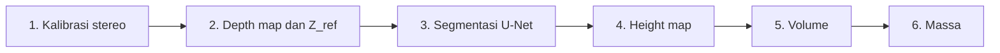

<h1 align="center">Coal Mass Estimation CV</h1>

  <b>Estimasi massa muatan batu bara tanpa kontak</b> 
  Segmentasi U-Net dan stereo vision pada miniatur gerbong kereta

  
  
  

  

## Ringkasan

Sistem ini mengestimasi massa batu bara pada gerbong **tanpa menyentuh muatan**, sebagai alternatif timbangan rel statis atau sensor yang mahal. Sepasang foto stereo diolah menjadi tinggi tumpukan: U-Net mengenali area batu bara, stereo vision mengukur jaraknya, lalu tinggi tersebut dijumlahkan menjadi volume dan dikonversi menjadi massa. Sistem diuji pada miniatur skala laboratorium dan merupakan bagian dari skripsi Teknik Elektro, Universitas Airlangga.

## Hasil utama

| IoU segmentasi | Galat kedalaman | MAPE massa | R² massa |
|:---:|:---:|:---:|:---:|
| **0,9718** | **0,27 cm** | **4,1%** | **0,9978** |
| 30 citra uji | MAE, 7 titik uji balok | 66 sampel dan data uji | 0,9960 pada data uji |

## Cara kerja

Setiap tahap memiliki kriteria kelayakan yang harus dipenuhi sebelum lanjut ke tahap berikutnya.

**[Lihat penjelasan bergambar tiap tahap](PIPELINE.md)**

## Sorotan

- **Validasi bertahap.** Setiap tahap diperiksa dengan kriteria yang jelas, misalnya RMS kalibrasi < 0,5 px dan IoU > 0,70.
- **Uji kedalaman dengan balok acuan 5 cm.** Error maksimum 0,55 cm, di bawah batas 1 cm.
- **Enam model konversi volume ke massa dibandingkan**, dievaluasi pada seluruh data dan pada data uji yang dipisahkan.

## Teknologi

Python · OpenCV (ChArUco, StereoSGBM) · PyTorch (U-Net) · NumPy · Matplotlib · Google Colab · Roboflow

<b>Isi repositori</b>

| Folder | Isi |
|---|---|
| `hasil_kalibrasi/` | Parameter kalibrasi, matriks stereo, dan *stereo map* |
| `hasil_evaluasi_stereo_05b_mode_ukur/` | Uji kedalaman dengan jarak lantai dan balok acuan |
| `hasil_training_unet_colab/` | Kurva training dan contoh prediksi U-Net |
| `hasil_evaluasi_unet/` | Metrik segmentasi per citra dan contoh *overlay* |
| `hasil_inference_unet/`, `hasil_integrasi_unet_depth/`, `hasil_volume_homografi/` | Contoh hasil inferensi, integrasi, dan volume (hanya beberapa contoh) |
| `hasil_evaluasi_volume_homografi/` | Evaluasi volume |
| `hasil_18_...`, `hasil_19_...` | Perbandingan model dan dashboard estimasi massa |

Hasil lengkap dapat dibuat ulang dengan menjalankan skrip terkait.

<b>Daftar skrip</b>

Skrip diberi nomor sesuai urutan pengerjaan. Ringkasannya juga ada di `00_README_URUTAN_ALUR_MASSA.txt`.

| No. | Fungsi |
|---|---|
| 01 | Pengambilan citra ChArUco stereo |
| 02 | Kalibrasi intrinsik kamera kiri dan kanan |
| 03 | Kalibrasi stereo |
| 04 | Rektifikasi dan pembuatan *stereo map* |
| 05 | Evaluasi kalibrasi dan rektifikasi |
| 06 | Pembuatan depth map |
| 07 | Evaluasi akurasi kedalaman (jarak lantai dan balok) |
| 08 | Akuisisi dataset U-Net |
| 09 | Panduan anotasi manual di Roboflow |
| 10 | Preprocessing hasil ekspor Roboflow |
| 11 | Normalisasi *mask* menjadi biner |
| 12 | Training U-Net (Google Colab) |
| 13 | Inferensi segmentasi |
| 14 | Evaluasi segmentasi (IoU, Dice, precision, recall) |
| 15 | Integrasi segmentasi dan kedalaman menjadi height map |
| 16 | Perhitungan volume dengan homografi |
| 17 | Evaluasi volume |
| 18 | Perbandingan model konversi volume ke massa |
| 19 | Estimasi massa dengan semua model |
| 20 | Demo *near real-time* |

## Model dan dataset

Bobot model U-Net dan dataset tidak disertakan karena ukurannya besar. Tautan unduhan: **[akan ditambahkan]**

## Menjalankan

1. Pasang kebutuhan: `pip install -r requirements.txt`
2. Jalankan skrip 01 sampai 05 untuk kalibrasi kamera dan rektifikasi.
3. Siapkan model dan dataset (unduh dari tautan di atas, atau buat sendiri melalui skrip 08 sampai 12; skrip 12 dijalankan di Google Colab).
4. Jalankan skrip 13 dan 15 sampai 16 untuk segmentasi dan volume, lalu skrip 18 dan 19 untuk estimasi massa, atau skrip 20 untuk demo.

Sesuaikan jalur (*path*) folder di dalam tiap skrip dengan lokasi berkas di komputer Anda.

## Keterbatasan

- Sistem diuji pada miniatur skala laboratorium; kondisi lapangan (debu, getaran, pencahayaan, dan ukuran gerbong sebenarnya) belum diuji.
- Hasil di repositori ini menggunakan *baseline* 10 cm. Konfigurasi 15 cm baru diuji pada tahap kalibrasi, sehingga pengaruh *baseline* terhadap akurasi belum dapat dibandingkan.
- Evaluasi pada data uji memakai satu pembagian 80:20 (13 sampel); validasi silang berulang masih diperlukan.

---

Enina Devianti Farid · Teknik Elektro, Universitas Airlangga

